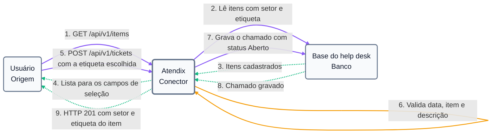
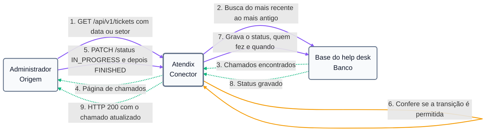
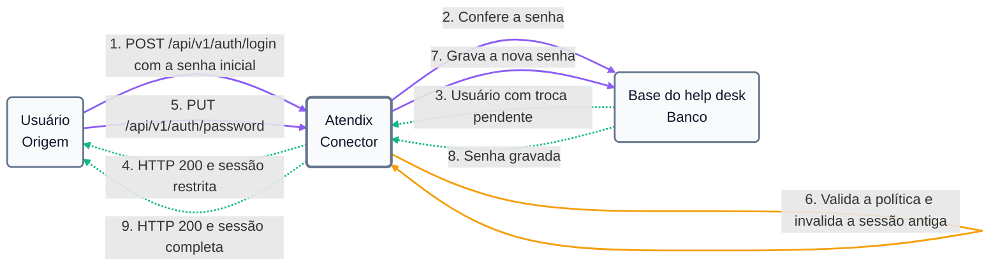

# Atendix

Atendix é um help desk web para abrir e acompanhar chamados de reparo de equipamentos (computadores, impressoras, monitores). Quem usa abre um chamado escolhendo a etiqueta de patrimônio do equipamento e descrevendo o problema; o sistema já sabe qual é o item e em que setor ele fica. O administrador acompanha todos os chamados, filtra por data ou setor, conduz a tratativa até a finalização e mantém os cadastros de setores, etiquetas, itens e usuários. Todas as operações são síncronas: cada ação responde na hora com o resultado.

**Abertura de chamados:** o usuário escolhe a etiqueta (ou setor e item), informa a data e a descrição; o chamado nasce com status Aberto e aparece no relatório, do mais recente para o mais antigo.

**Tratativa pelo administrador:** o administrador inicia o atendimento e só depois finaliza o chamado; o sistema registra quem iniciou, quem finalizou e quando. Enquanto ninguém começou a atender, quem abriu pode cancelar, e o chamado é excluído. Cada item tem no máximo um chamado aberto ou em andamento por vez.

**Cadastros:** setores, etiquetas e itens são cadastrados pelo administrador; cada item fica em um setor e tem uma etiqueta exclusiva.

**Primeiro acesso:** toda conta nasce com a senha inicial `mudar@123`, e o sistema exige a troca antes de liberar qualquer outra tela.

[Como rodar](#como-rodar) · [Usuários para login](#usuários-para-login) · [Perfis e permissões](#perfis-e-permissões) · [Endpoints](#endpoints) · [Abertura de chamados](#abertura-de-chamados) · [Tratativa pelo administrador](#tratativa-pelo-administrador) · [Primeiro acesso](#primeiro-acesso) · [Payload de erro](#payload-de-erro) · [Exemplos de chamada](#exemplos-de-chamada)

---

## Como rodar

### Pré-requisitos

| Ferramenta | Versão |
|---|---|
| JDK | 25 |
| Maven | 3.9 ou superior |
| Node.js | 22.22+ ou 24.15+ (com npm) |
| Docker | com Docker Compose |

### 1. Variáveis de ambiente

Copie o modelo e preencha a senha do banco e o segredo de assinatura dos tokens:

```bash
cp .env.example .env
```

| Variável | Para que serve | Exemplo |
|---|---|---|
| `DB_HOST` | Host do banco | `localhost` |
| `DB_PORT` | Porta do banco no host | `5433` |
| `DB_NAME` | Nome do banco | `atendix` |
| `DB_USER` | Usuário do banco | `atendix` |
| `DB_PASSWORD` | Senha do banco (escolha uma) | — |
| `JWT_SECRET` | Segredo dos tokens, com no mínimo 32 caracteres | gere com `openssl rand -base64 48` |
| `COOKIE_SECURE` | Cookies só por HTTPS ou localhost. Use `false` para acessar pelo IP da rede local (ex.: `http://192.168.0.10:4200`); com `true`, o navegador descarta os cookies de sessão nesse caso | `true` |

O `.env` não vai para o repositório. O banco e a API leem o mesmo arquivo.

### 2. Banco de dados

```bash
docker compose up -d
```

Sobe o PostgreSQL na porta `5433` do host. As tabelas e os [usuários padrão](#usuários-para-login) são criados automaticamente quando a API sobe. Setores, etiquetas e itens começam vazios e são cadastrados pelo administrador em **Cadastros**.

### 3. API

Na raiz do projeto:

```bash
mvn spring-boot:run
```

A API fica em `http://localhost:8080`.

### 4. Interface web

Em outro terminal:

```bash
cd frontend
```

```bash
npm install
```

```bash
npm start
```

Abra `http://localhost:4200`. A interface encaminha as chamadas `/api` para a API, então front e API funcionam como um único endereço.

### Testes

API (unitários e de integração; os de integração sobem um PostgreSQL temporário e precisam do Docker em execução):

```bash
mvn verify
```

Interface web:

```bash
cd frontend
```

```bash
npm test -- --watch=false
```

### Estrutura do repositório

| Pasta | Conteúdo |
|---|---|
| `src/` | API: regras de negócio, endpoints, segurança e migrações do banco |
| `frontend/` | Interface web |
| `design-system/` | Design system do Atendix (cores, tipografia, ícones e componentes de referência) |
| `SPECS-PROFESSOR.md` | Enunciado do trabalho |

---

## Usuários para login

O banco já nasce com duas contas, uma de cada perfil:

| Login | Senha inicial | Perfil |
|---|---|---|
| `admin` | `mudar@123` | Administrador (1) |
| `usuario` | `mudar@123` | Usuário comum (0) |

No primeiro login de cada conta, o sistema pede uma senha pessoal: de 8 a 128 caracteres, com letra maiúscula, letra minúscula, número e caractere especial, diferente da senha inicial. A partir daí, o login usa a senha nova.

Contas criadas pelo administrador também nascem com `mudar@123`. Se alguém esquecer a senha, o administrador usa **Redefinir senha** e ela volta a ser `mudar@123`, com a troca exigida no próximo acesso.

**Regras de acesso**

- Depois de **5 senhas erradas** para o mesmo login, ele fica bloqueado por **15 minutos** (configurável em `app.security.login.*`).
- Uma conta **desativada** pelo administrador não entra; os chamados dela continuam no histórico e ela pode ser reativada.
- Redefinir a senha, mudar o perfil ou desativar uma conta **encerra na hora** as sessões abertas dessa pessoa. Trocar a própria senha encerra as sessões em outros dispositivos.

**Duas contas ao mesmo tempo.** A sessão fica em cookies, que são do navegador inteiro e não de cada aba. Entrar com outra conta numa aba troca a conta de todas as abas abertas, e elas acompanham sozinhas (o mesmo vale para o logout). Para usar o admin e o usuário comum lado a lado, abra o segundo em uma janela anônima ou em outro navegador.

---

## Perfis e permissões

O perfil é gravado como número: `0` para usuário comum e `1` para administrador.

| Ação | Usuário comum (0) | Administrador (1) |
|---|---|---|
| Abrir chamado | Sim | Sim |
| Ver o relatório de chamados | Só os que abriu | Todos |
| Buscar chamados por data ou setor | Não | Sim |
| Cancelar chamado ainda aberto | Os que abriu | Qualquer um |
| Iniciar atendimento e finalizar chamado | Não | Sim |
| Cadastrar e editar setores, etiquetas e itens | Não | Sim |
| Cadastrar usuários, mudar perfil e redefinir senha | Não | Sim (menos o próprio perfil) |
| Desativar e reativar contas | Não | Sim (menos a própria) |

### Cores de status

| Status | Cor | Significado |
|---|---|---|
| `OPEN` | Verde | Aberto, ninguém começou a atender |
| `IN_PROGRESS` | Amarelo | Em andamento |
| `FINISHED` | Vermelho | Finalizado |

A cor sempre vem acompanhada do nome do status, para não depender só da cor.

---

## Autenticação

A API usa **tokens em cookies**. Não há header `Authorization`: depois do login, o navegador (ou o `curl` com um arquivo de cookies) envia os cookies sozinho.

| Cookie | Conteúdo | Validade | Enviado para |
|---|---|---|---|
| `atendix_access_token` | Token de acesso | 15 minutos | `/api` |
| `atendix_refresh_token` | Token de renovação | 7 dias | `/api/v1/auth` |
| `XSRF-TOKEN` | Token anti-CSRF | sessão | todo o site |

Os dois primeiros são `HttpOnly`, `Secure` e `SameSite=Strict`: scripts da página não conseguem lê-los.

**Proteção contra CSRF.** Toda requisição que altera dados (POST, PUT, PATCH, DELETE), inclusive o login, precisa repetir o valor do cookie `XSRF-TOKEN` no header `X-XSRF-TOKEN`. O cookie é emitido por `GET /api/v1/auth/csrf` e se mantém durante a navegação. Se uma requisição for recusada por CSRF, a resposta vem com `"error": "Token CSRF inválido"`; a interface web busca um token novo e repete a requisição uma única vez, automaticamente.

**Renovação.** Quando o token de acesso expira, `POST /api/v1/auth/refresh` troca o token de renovação por um par novo. Cada token de renovação vale uma única vez.

**Logout.** `POST /api/v1/auth/logout` invalida os dois tokens até a expiração deles e apaga os cookies. Trocar a senha também invalida a sessão anterior.

**Senha inicial pendente.** Enquanto a senha inicial não for trocada, a sessão só permite trocar a senha, consultar o próprio usuário e sair. As demais rotas respondem `403` com a mensagem "Troque a senha inicial antes de continuar."

---

## Swagger / Documentação interativa

| Ambiente | URL |
|---|---|
| Local | http://localhost:8080/swagger-ui.html |
| Quality | — |
| Produção | — |

---

## Endpoints

Todas as rotas começam com `/api/v1`. As datas seguem o formato `AAAA-MM-DD` e os instantes estão em UTC.

### Autenticação

### `GET /api/v1/auth/csrf`

Emite o cookie `XSRF-TOKEN`, usado no header `X-XSRF-TOKEN` das requisições que alteram dados.

#### Response — `204 No Content`

Cookie `XSRF-TOKEN` gravado; sem corpo.

#### Status codes

| Código | Situação |
|---|---|
| `204 No Content` | Cookie emitido |

### `POST /api/v1/auth/login`

Autentica o usuário e grava os cookies de sessão.

#### Request Body

Arquivo: `login.json`

```json
{
  "login": "admin",
  "password": "mudar@123"
}
```

| Campo | Tipo | Obrigatório | Descrição |
|---|---|---|---|
| `login` | `string` | Sim | Login do usuário, até 40 caracteres |
| `password` | `string` | Sim | Senha, até 128 caracteres |

#### Response — `200 OK`

Login aceito. Se `mustChangePassword` vier `true`, o próximo passo é trocar a senha.

```json
{
  "id": "6f1d2c3b-4a59-4e8d-9c7b-1a2b3c4d5e6f",
  "name": "Administrador",
  "login": "admin",
  "role": "ADMIN",
  "mustChangePassword": true,
  "active": true,
  "createdAt": "2026-11-07T12:57:52Z"
}
```

#### Status codes

| Código | Situação |
|---|---|
| `200 OK` | Login realizado; cookies gravados |
| `400 Bad Request` | Login ou senha não informados |
| `401 Unauthorized` | Login ou senha inválidos, ou conta desativada |
| `403 Forbidden` | Header `X-XSRF-TOKEN` ausente ou diferente do cookie |
| `429 Too Many Requests` | Login bloqueado por 15 minutos após 5 senhas erradas |

### `POST /api/v1/auth/refresh`

Troca o token de renovação (cookie) por um par novo de tokens. Sem corpo.

#### Response — `200 OK`

Mesmo corpo do login, com o usuário da sessão renovada.

#### Status codes

| Código | Situação |
|---|---|
| `200 OK` | Sessão renovada; cookies novos gravados |
| `401 Unauthorized` | Token de renovação ausente, expirado ou já usado |
| `403 Forbidden` | Token CSRF ausente ou inválido |

### `POST /api/v1/auth/logout`

Encerra a sessão: invalida os tokens ainda válidos e apaga os cookies. Sem corpo.

#### Status codes

| Código | Situação |
|---|---|
| `204 No Content` | Sessão encerrada |
| `403 Forbidden` | Token CSRF ausente ou inválido |

### `PUT /api/v1/auth/password`

Troca a senha do usuário autenticado. Obrigatório no primeiro acesso. Invalida a sessão atual e grava cookies novos.

#### Request Body

Arquivo: `trocar-senha.json`

```json
{
  "currentPassword": "mudar@123",
  "newPassword": "Chamados#2026"
}
```

| Campo | Tipo | Obrigatório | Descrição |
|---|---|---|---|
| `currentPassword` | `string` | Sim | Senha em uso (a inicial, no primeiro acesso) |
| `newPassword` | `string` | Sim | De 8 a 128 caracteres, com maiúscula, minúscula, número e caractere especial |

#### Response — `200 OK`

Senha trocada; `mustChangePassword` passa a `false`.

```json
{
  "id": "6f1d2c3b-4a59-4e8d-9c7b-1a2b3c4d5e6f",
  "name": "Administrador",
  "login": "admin",
  "role": "ADMIN",
  "mustChangePassword": false,
  "active": true,
  "createdAt": "2026-11-07T12:57:52Z"
}
```

#### Status codes

| Código | Situação |
|---|---|
| `200 OK` | Senha alterada; cookies novos gravados |
| `400 Bad Request` | Nova senha fora da política |
| `401 Unauthorized` | Sessão ausente, expirada ou inválida |
| `403 Forbidden` | Token CSRF ausente ou inválido |
| `422 Unprocessable Content` | Senha atual incorreta, ou nova senha igual à inicial ou à atual |

### Usuários

### `GET /api/v1/users/me`

Retorna o usuário autenticado. Disponível também com a senha inicial pendente.

#### Response — `200 OK`

Mesmo formato do login.

#### Status codes

| Código | Situação |
|---|---|
| `200 OK` | Dados do usuário autenticado |
| `401 Unauthorized` | Sessão ausente, expirada ou inválida |

### `POST /api/v1/users`

Cadastra um usuário com a senha inicial. Exclusivo do administrador.

#### Request Body

Arquivo: `cadastrar-usuario.json`

```json
{
  "name": "Maria Souza",
  "login": "maria.souza",
  "role": "COMMON"
}
```

| Campo | Tipo | Obrigatório | Descrição |
|---|---|---|---|
| `name` | `string` | Sim | Nome completo, até 120 caracteres |
| `login` | `string` | Sim | De 3 a 40 caracteres: letras, números, ponto, hífen ou sublinhado; gravado em minúsculas |
| `role` | `string` | Sim | `COMMON` (0) ou `ADMIN` (1) |

#### Response — `201 Created`

Usuário criado; o header `Location` aponta para ele.

```json
{
  "id": "0b7c4e2a-31d5-4f6a-8e9b-2c3d4e5f6a7b",
  "name": "Maria Souza",
  "login": "maria.souza",
  "role": "COMMON",
  "mustChangePassword": true,
  "active": true,
  "createdAt": "2026-11-07T13:10:00Z"
}
```

#### Status codes

| Código | Situação |
|---|---|
| `201 Created` | Usuário cadastrado |
| `400 Bad Request` | Payload inválido |
| `401 Unauthorized` | Sessão ausente, expirada ou inválida |
| `403 Forbidden` | Usuário não é administrador ou token CSRF inválido |
| `409 Conflict` | Login já cadastrado |

#### Valores de `role`

| Valor | Código | Descrição |
|---|---|---|
| `COMMON` | 0 | Usuário comum |
| `ADMIN` | 1 | Administrador |

### `GET /api/v1/users`

Lista os usuários em ordem de nome. Exclusivo do administrador.

#### Parâmetros

| Parâmetro | Tipo | Obrigatório | Descrição |
|---|---|---|---|
| `page` | `integer` | Não | Página, começando em 0 (padrão 0) |
| `size` | `integer` | Não | Itens por página, de 1 a 100 (padrão 20) |

#### Response — `200 OK`

```json
{
  "content": [
    {
      "id": "0b7c4e2a-31d5-4f6a-8e9b-2c3d4e5f6a7b",
      "name": "Maria Souza",
      "login": "maria.souza",
      "role": "COMMON",
      "mustChangePassword": true,
      "active": true,
      "createdAt": "2026-11-07T13:10:00Z"
    }
  ],
  "page": 0,
  "size": 20,
  "totalElements": 1,
  "totalPages": 1
}
```

#### Status codes

| Código | Situação |
|---|---|
| `200 OK` | Página de usuários |
| `400 Bad Request` | Paginação inválida |
| `401 Unauthorized` | Sessão ausente, expirada ou inválida |
| `403 Forbidden` | Usuário não é administrador |

### `PATCH /api/v1/users/{userId}/role`

Muda o perfil de um usuário. Exclusivo do administrador; o próprio perfil não pode ser alterado. As sessões abertas da pessoa são encerradas, para que o perfil novo valha na hora.

#### Parâmetros

| Parâmetro | Tipo | Obrigatório | Descrição |
|---|---|---|---|
| `userId` | `UUID` | Sim | Identificador do usuário |

#### Request Body

Arquivo: `alterar-perfil.json`

```json
{
  "role": "ADMIN"
}
```

| Campo | Tipo | Obrigatório | Descrição |
|---|---|---|---|
| `role` | `string` | Sim | `COMMON` ou `ADMIN` |

#### Response — `200 OK`

Usuário com o perfil novo, no mesmo formato do cadastro.

#### Status codes

| Código | Situação |
|---|---|
| `200 OK` | Perfil alterado |
| `400 Bad Request` | Payload inválido |
| `401 Unauthorized` | Sessão ausente, expirada ou inválida |
| `403 Forbidden` | Usuário não é administrador ou token CSRF inválido |
| `404 Not Found` | Usuário não encontrado |
| `422 Unprocessable Content` | Tentativa de alterar o próprio perfil |

### `POST /api/v1/users/{userId}/password-reset`

Volta a senha do usuário para a inicial, encerra as sessões abertas dele e exige a troca no próximo acesso. Exclusivo do administrador. Sem corpo.

#### Parâmetros

| Parâmetro | Tipo | Obrigatório | Descrição |
|---|---|---|---|
| `userId` | `UUID` | Sim | Identificador do usuário |

#### Status codes

| Código | Situação |
|---|---|
| `204 No Content` | Senha redefinida |
| `401 Unauthorized` | Sessão ausente, expirada ou inválida |
| `403 Forbidden` | Usuário não é administrador ou token CSRF inválido |
| `404 Not Found` | Usuário não encontrado |

### `PATCH /api/v1/users/{userId}/active`

Desativa ou reativa uma conta. Exclusivo do administrador; a própria conta não pode ser desativada. A conta desativada não entra e tem as sessões encerradas na hora; os chamados dela continuam no histórico.

#### Parâmetros

| Parâmetro | Tipo | Obrigatório | Descrição |
|---|---|---|---|
| `userId` | `UUID` | Sim | Identificador do usuário |

#### Request Body

Arquivo: `desativar-usuario.json`

```json
{
  "active": false
}
```

| Campo | Tipo | Obrigatório | Descrição |
|---|---|---|---|
| `active` | `boolean` | Sim | `true` para ativar, `false` para desativar |

#### Response — `200 OK`

Usuário com a situação nova, no mesmo formato do cadastro (`"active": false` quando desativado).

#### Status codes

| Código | Situação |
|---|---|
| `200 OK` | Situação da conta alterada |
| `400 Bad Request` | Payload inválido |
| `401 Unauthorized` | Sessão ausente, expirada ou inválida |
| `403 Forbidden` | Usuário não é administrador ou token CSRF inválido |
| `404 Not Found` | Usuário não encontrado |
| `422 Unprocessable Content` | Tentativa de desativar a própria conta |

### Setores

Leitura liberada a todos os usuários autenticados (a abertura de chamados usa a lista); cadastro, edição e exclusão são exclusivos do administrador.

### `GET /api/v1/sectors`

Lista os setores em ordem de nome.

#### Response — `200 OK`

```json
[
  {
    "id": "5f0c3a52-7d1e-4c9b-8a2f-1b3c4d5e6f70",
    "name": "Financeiro",
    "createdAt": "2026-11-07T14:00:00Z"
  }
]
```

#### Status codes

| Código | Situação |
|---|---|
| `200 OK` | Setores cadastrados |
| `401 Unauthorized` | Sessão ausente, expirada ou inválida |

### `POST /api/v1/sectors`

Cadastra um setor.

#### Request Body

Arquivo: `cadastrar-setor.json`

```json
{
  "name": "Financeiro"
}
```

| Campo | Tipo | Obrigatório | Descrição |
|---|---|---|---|
| `name` | `string` | Sim | Nome do setor, até 80 caracteres; único sem diferenciar maiúsculas |

#### Response — `201 Created`

Setor criado, no formato da listagem.

#### Status codes

| Código | Situação |
|---|---|
| `201 Created` | Setor cadastrado |
| `400 Bad Request` | Payload inválido |
| `401 Unauthorized` | Sessão ausente, expirada ou inválida |
| `403 Forbidden` | Usuário não é administrador ou token CSRF inválido |
| `409 Conflict` | Já existe um setor com esse nome |

### `PUT /api/v1/sectors/{sectorId}`

Renomeia um setor. Mesmo corpo do cadastro.

#### Status codes

| Código | Situação |
|---|---|
| `200 OK` | Setor editado |
| `400 Bad Request` | Payload inválido |
| `401 Unauthorized` | Sessão ausente, expirada ou inválida |
| `403 Forbidden` | Usuário não é administrador ou token CSRF inválido |
| `404 Not Found` | Setor não encontrado |
| `409 Conflict` | Já existe outro setor com esse nome |

### `DELETE /api/v1/sectors/{sectorId}`

Exclui um setor sem itens.

#### Status codes

| Código | Situação |
|---|---|
| `204 No Content` | Setor excluído |
| `401 Unauthorized` | Sessão ausente, expirada ou inválida |
| `403 Forbidden` | Usuário não é administrador ou token CSRF inválido |
| `404 Not Found` | Setor não encontrado |
| `409 Conflict` | O setor tem itens cadastrados |

### Etiquetas

Mesma regra de acesso dos setores.

### `GET /api/v1/asset-tags`

Lista as etiquetas em ordem de código, com o item que cada uma identifica.

#### Response — `200 OK`

`itemId` e `itemName` vêm `null` enquanto a etiqueta estiver livre.

```json
[
  {
    "id": "9a8b7c6d-5e4f-4a3b-9c2d-1e0f9a8b7c6d",
    "code": "PAT-004512",
    "itemId": "3d2c1b0a-9f8e-4d7c-8b6a-5f4e3d2c1b0a",
    "itemName": "Impressora HP LaserJet",
    "createdAt": "2026-11-07T14:00:00Z"
  }
]
```

#### Status codes

| Código | Situação |
|---|---|
| `200 OK` | Etiquetas cadastradas |
| `401 Unauthorized` | Sessão ausente, expirada ou inválida |

### `POST /api/v1/asset-tags`

Cadastra uma etiqueta. O código é gravado em maiúsculas.

#### Request Body

Arquivo: `cadastrar-etiqueta.json`

```json
{
  "code": "PAT-004512"
}
```

| Campo | Tipo | Obrigatório | Descrição |
|---|---|---|---|
| `code` | `string` | Sim | Código impresso na etiqueta, até 40 caracteres; único |

#### Status codes

| Código | Situação |
|---|---|
| `201 Created` | Etiqueta cadastrada |
| `400 Bad Request` | Payload inválido |
| `401 Unauthorized` | Sessão ausente, expirada ou inválida |
| `403 Forbidden` | Usuário não é administrador ou token CSRF inválido |
| `409 Conflict` | Já existe uma etiqueta com esse código |

### `PUT /api/v1/asset-tags/{assetTagId}`

Altera o código de uma etiqueta. Mesmo corpo do cadastro.

#### Status codes

| Código | Situação |
|---|---|
| `200 OK` | Etiqueta editada |
| `400 Bad Request` | Payload inválido |
| `401 Unauthorized` | Sessão ausente, expirada ou inválida |
| `403 Forbidden` | Usuário não é administrador ou token CSRF inválido |
| `404 Not Found` | Etiqueta não encontrada |
| `409 Conflict` | Já existe outra etiqueta com esse código |

### `DELETE /api/v1/asset-tags/{assetTagId}`

Exclui uma etiqueta livre.

#### Status codes

| Código | Situação |
|---|---|
| `204 No Content` | Etiqueta excluída |
| `401 Unauthorized` | Sessão ausente, expirada ou inválida |
| `403 Forbidden` | Usuário não é administrador ou token CSRF inválido |
| `404 Not Found` | Etiqueta não encontrada |
| `409 Conflict` | A etiqueta está ligada a um item |

### Itens

Mesma regra de acesso dos setores.

### `GET /api/v1/items`

Lista os itens em ordem de nome, com setor e etiqueta.

#### Parâmetros

| Parâmetro | Tipo | Obrigatório | Descrição |
|---|---|---|---|
| `sectorId` | `UUID` | Não | Mostra só os itens deste setor |

#### Response — `200 OK`

```json
[
  {
    "id": "3d2c1b0a-9f8e-4d7c-8b6a-5f4e3d2c1b0a",
    "name": "Impressora HP LaserJet",
    "sectorId": "5f0c3a52-7d1e-4c9b-8a2f-1b3c4d5e6f70",
    "sectorName": "Financeiro",
    "assetTagId": "9a8b7c6d-5e4f-4a3b-9c2d-1e0f9a8b7c6d",
    "assetTagCode": "PAT-004512",
    "createdAt": "2026-11-07T14:00:00Z"
  }
]
```

#### Status codes

| Código | Situação |
|---|---|
| `200 OK` | Itens cadastrados |
| `400 Bad Request` | `sectorId` não é um UUID |
| `401 Unauthorized` | Sessão ausente, expirada ou inválida |

### `POST /api/v1/items`

Cadastra um item em um setor, identificado por uma etiqueta livre.

#### Request Body

Arquivo: `cadastrar-item.json`

```json
{
  "name": "Impressora HP LaserJet",
  "sectorId": "5f0c3a52-7d1e-4c9b-8a2f-1b3c4d5e6f70",
  "assetTagId": "9a8b7c6d-5e4f-4a3b-9c2d-1e0f9a8b7c6d"
}
```

| Campo | Tipo | Obrigatório | Descrição |
|---|---|---|---|
| `name` | `string` | Sim | Nome do equipamento, até 120 caracteres |
| `sectorId` | `UUID` | Sim | Setor onde o equipamento fica |
| `assetTagId` | `UUID` | Sim | Etiqueta do equipamento; precisa estar livre |

#### Response — `201 Created`

Item criado, no formato da listagem.

#### Status codes

| Código | Situação |
|---|---|
| `201 Created` | Item cadastrado |
| `400 Bad Request` | Payload inválido |
| `401 Unauthorized` | Sessão ausente, expirada ou inválida |
| `403 Forbidden` | Usuário não é administrador ou token CSRF inválido |
| `409 Conflict` | A etiqueta já pertence a outro item |
| `422 Unprocessable Content` | Setor ou etiqueta informados não existem |

### `PUT /api/v1/items/{itemId}`

Edita nome, setor e etiqueta de um item. Mesmo corpo do cadastro. Os chamados do item passam a mostrar o setor e a etiqueta novos.

#### Status codes

| Código | Situação |
|---|---|
| `200 OK` | Item editado |
| `400 Bad Request` | Payload inválido |
| `401 Unauthorized` | Sessão ausente, expirada ou inválida |
| `403 Forbidden` | Usuário não é administrador ou token CSRF inválido |
| `404 Not Found` | Item não encontrado |
| `409 Conflict` | A etiqueta já pertence a outro item |
| `422 Unprocessable Content` | Setor ou etiqueta informados não existem |

### `DELETE /api/v1/items/{itemId}`

Exclui um item sem chamados; a etiqueta dele fica livre.

#### Status codes

| Código | Situação |
|---|---|
| `204 No Content` | Item excluído |
| `401 Unauthorized` | Sessão ausente, expirada ou inválida |
| `403 Forbidden` | Usuário não é administrador ou token CSRF inválido |
| `404 Not Found` | Item não encontrado |
| `409 Conflict` | O item tem chamados registrados |

### Chamados

### `POST /api/v1/tickets`

Abre um chamado para um item cadastrado. Setor e etiqueta vêm do item; o status começa em `OPEN`. Um item só pode ter um chamado aberto ou em andamento por vez.

#### Request Body

Arquivo: `abrir-chamado.json`

```json
{
  "requestDate": "2026-11-07",
  "itemId": "3d2c1b0a-9f8e-4d7c-8b6a-5f4e3d2c1b0a",
  "problemDescription": "A impressora não puxa o papel da bandeja 2."
}
```

| Campo | Tipo | Obrigatório | Descrição |
|---|---|---|---|
| `requestDate` | `date` | Sim | Data da solicitação; não pode estar no futuro |
| `itemId` | `UUID` | Sim | Item com problema |
| `problemDescription` | `string` | Sim | Descrição do problema, até 2000 caracteres |

#### Response — `201 Created`

Chamado aberto; o header `Location` aponta para ele.

```json
{
  "id": "8f14e45f-ceea-467a-9575-0f9a2c6e0b1d",
  "requestDate": "2026-11-07",
  "itemId": "3d2c1b0a-9f8e-4d7c-8b6a-5f4e3d2c1b0a",
  "itemName": "Impressora HP LaserJet",
  "sectorId": "5f0c3a52-7d1e-4c9b-8a2f-1b3c4d5e6f70",
  "sector": "Financeiro",
  "assetTag": "PAT-004512",
  "problemDescription": "A impressora não puxa o papel da bandeja 2.",
  "status": "OPEN",
  "requesterId": "4c1a9e7b-2d3f-4b5a-8c6d-7e8f9a0b1c2d",
  "requesterName": "Usuário Comum",
  "startedByName": null,
  "startedAt": null,
  "finishedByName": null,
  "finishedAt": null,
  "createdAt": "2026-11-07T14:30:00Z",
  "updatedAt": "2026-11-07T14:30:00Z"
}
```

#### Status codes

| Código | Situação |
|---|---|
| `201 Created` | Chamado aberto |
| `400 Bad Request` | Payload inválido (inclui data no futuro) |
| `401 Unauthorized` | Sessão ausente, expirada ou inválida |
| `403 Forbidden` | Senha inicial ainda não trocada ou token CSRF inválido |
| `409 Conflict` | O item já tem um chamado aberto ou em andamento |
| `422 Unprocessable Content` | O item informado não existe |

### `GET /api/v1/tickets`

Relatório de chamados, sempre do mais recente para o mais antigo. O usuário comum vê só os chamados que abriu; o administrador vê todos e pode filtrar.

#### Parâmetros

| Parâmetro | Tipo | Obrigatório | Descrição |
|---|---|---|---|
| `date` | `date` | Não | Só chamados desta data. Exclusivo do administrador |
| `sectorId` | `UUID` | Não | Só chamados de itens deste setor. Exclusivo do administrador |
| `page` | `integer` | Não | Página, começando em 0 (padrão 0) |
| `size` | `integer` | Não | Itens por página, de 1 a 100 (padrão 20) |

#### Response — `200 OK`

Página de chamados, com cada item no formato da abertura.

```json
{
  "content": [
    {
      "id": "8f14e45f-ceea-467a-9575-0f9a2c6e0b1d",
      "requestDate": "2026-11-07",
      "itemId": "3d2c1b0a-9f8e-4d7c-8b6a-5f4e3d2c1b0a",
      "itemName": "Impressora HP LaserJet",
      "sectorId": "5f0c3a52-7d1e-4c9b-8a2f-1b3c4d5e6f70",
      "sector": "Financeiro",
      "assetTag": "PAT-004512",
      "problemDescription": "A impressora não puxa o papel da bandeja 2.",
      "status": "IN_PROGRESS",
      "requesterId": "4c1a9e7b-2d3f-4b5a-8c6d-7e8f9a0b1c2d",
      "requesterName": "Usuário Comum",
      "startedByName": "Administrador",
      "startedAt": "2026-11-07T15:00:00Z",
      "finishedByName": null,
      "finishedAt": null,
      "createdAt": "2026-11-07T14:30:00Z",
      "updatedAt": "2026-11-07T15:05:00Z"
    }
  ],
  "page": 0,
  "size": 20,
  "totalElements": 1,
  "totalPages": 1
}
```

#### Status codes

| Código | Situação |
|---|---|
| `200 OK` | Página de chamados |
| `400 Bad Request` | Filtro ou paginação inválidos |
| `401 Unauthorized` | Sessão ausente, expirada ou inválida |
| `403 Forbidden` | Usuário comum usando filtro de data ou setor |

### `GET /api/v1/tickets/{ticketId}`

Consulta um chamado. O usuário comum só consulta os que abriu; o de outra pessoa responde como não encontrado.

#### Parâmetros

| Parâmetro | Tipo | Obrigatório | Descrição |
|---|---|---|---|
| `ticketId` | `UUID` | Sim | Identificador do chamado |

#### Status codes

| Código | Situação |
|---|---|
| `200 OK` | Dados do chamado |
| `401 Unauthorized` | Sessão ausente, expirada ou inválida |
| `404 Not Found` | Chamado não encontrado ou de outro usuário |

### `DELETE /api/v1/tickets/{ticketId}`

Cancela um chamado ainda `OPEN`. O chamado cancelado é excluído do sistema.

#### Status codes

| Código | Situação |
|---|---|
| `204 No Content` | Chamado cancelado e excluído |
| `401 Unauthorized` | Sessão ausente, expirada ou inválida |
| `403 Forbidden` | Token CSRF ausente ou inválido |
| `404 Not Found` | Chamado não encontrado ou de outro usuário |
| `409 Conflict` | Chamado com tratativa já iniciada |

### `PATCH /api/v1/tickets/{ticketId}/status`

Altera o status de um chamado. Exclusivo do administrador. O atendimento precisa ser iniciado (`IN_PROGRESS`) antes de ser finalizado (`FINISHED`); cada passo registra quem fez e quando (`startedByName`/`startedAt` e `finishedByName`/`finishedAt`).

#### Request Body

Arquivo: `alterar-status.json`

```json
{
  "status": "IN_PROGRESS"
}
```

| Campo | Tipo | Obrigatório | Descrição |
|---|---|---|---|
| `status` | `string` | Sim | `IN_PROGRESS` ou `FINISHED` |

#### Response — `200 OK`

Chamado com o status novo, no formato da abertura.

#### Status codes

| Código | Situação |
|---|---|
| `200 OK` | Status alterado |
| `400 Bad Request` | Status ausente ou desconhecido |
| `401 Unauthorized` | Sessão ausente, expirada ou inválida |
| `403 Forbidden` | Usuário não é administrador ou token CSRF inválido |
| `404 Not Found` | Chamado não encontrado |
| `409 Conflict` | Transição de status não permitida (por exemplo, finalizar sem iniciar) |

#### Ciclo de vida do `status`

| Valor | Descrição | Pode ir para |
|---|---|---|
| `OPEN` | Aberto; ninguém começou a atender. Único status em que o chamado pode ser cancelado | `IN_PROGRESS` |
| `IN_PROGRESS` | Em andamento | `FINISHED` |
| `FINISHED` | Finalizado; não muda mais | — |

---

## Abertura de chamados



O desenho representa somente o sucesso. Data no futuro, campo vazio, item inexistente ou item que já tem um chamado aberto ou em andamento encerram o fluxo no passo 6, antes da gravação.

## Tratativa pelo administrador



O desenho representa somente o sucesso. Finalizar um chamado que ninguém iniciou, ou voltar um status (por exemplo, de Finalizado para Aberto), encerra o fluxo no passo 6 com `409`.

## Primeiro acesso



O desenho representa somente o sucesso. Senha errada encerra o fluxo no passo 2 com `401`; nova senha fora da política ou igual à inicial encerra no passo 6.

---

## Payload de erro

Todas as respostas de erro seguem o mesmo formato padronizado, independente do tipo de falha ocorrida.

```json
{
  "timestamp": "2026-11-07T11:45:12.123456",
  "status": 400,
  "error": "Validação de campos falhou",
  "message": "Um ou mais campos estão inválidos. Verifique a requisição.",
  "fields": {
    "requestDate": "A data do chamado não pode estar no futuro"
  }
}
```

| Campo | Tipo | Descrição |
|---|---|---|
| `timestamp` | `string` | Momento exato em que o erro ocorreu |
| `status` | `integer` | Código HTTP do erro |
| `error` | `string` | Classificação do erro |
| `message` | `string` | Descrição legível do que ocorreu |
| `fields` | `objeto` | Presente apenas em erros de validação: mapeia cada campo inválido à sua mensagem. Nos demais erros o valor é `null` |

## Exemplos de erros comuns

**Login ou senha inválidos — `401 Unauthorized`**
```json
{
  "timestamp": "2026-11-07T11:46:02.481920",
  "status": 401,
  "error": "Não autenticado",
  "message": "Login ou senha inválidos",
  "fields": null
}
```

**Senha inicial ainda não trocada — `403 Forbidden`**
```json
{
  "timestamp": "2026-11-07T11:47:15.120334",
  "status": 403,
  "error": "Acesso negado",
  "message": "Troque a senha inicial antes de continuar.",
  "fields": null
}
```

**Cancelar chamado em andamento — `409 Conflict`**
```json
{
  "timestamp": "2026-11-07T11:48:40.902117",
  "status": 409,
  "error": "Conflito com o estado atual",
  "message": "O chamado 8f14e45f-ceea-467a-9575-0f9a2c6e0b1d não pode ser cancelado porque já possui tratativa iniciada (status IN_PROGRESS)",
  "fields": null
}
```

**Etiqueta já usada por outro item — `409 Conflict`**
```json
{
  "timestamp": "2026-11-07T11:49:05.334812",
  "status": 409,
  "error": "Conflito com o estado atual",
  "message": "A etiqueta já pertence a outro item",
  "fields": null
}
```

**Excluir setor com itens — `409 Conflict`**
```json
{
  "timestamp": "2026-11-07T11:50:21.775104",
  "status": 409,
  "error": "Conflito com o estado atual",
  "message": "O setor tem itens cadastrados. Mova ou exclua os itens antes de excluir o setor.",
  "fields": null
}
```

**Usuário comum filtrando por setor — `403 Forbidden`**
```json
{
  "timestamp": "2026-11-07T11:51:33.018265",
  "status": 403,
  "error": "Acesso negado",
  "message": "Apenas administradores podem buscar chamados por data ou setor",
  "fields": null
}
```

**Finalizar um chamado que ninguém iniciou — `409 Conflict`**
```json
{
  "timestamp": "2026-11-07T11:52:10.441093",
  "status": 409,
  "error": "Conflito com o estado atual",
  "message": "Não é possível alterar o chamado 8f14e45f-ceea-467a-9575-0f9a2c6e0b1d de OPEN para FINISHED. O atendimento precisa ser iniciado antes de ser finalizado.",
  "fields": null
}
```

**Segundo chamado para um item ainda em atendimento — `409 Conflict`**
```json
{
  "timestamp": "2026-11-07T11:53:02.180557",
  "status": 409,
  "error": "Conflito com o estado atual",
  "message": "Este item já tem um chamado em andamento, aberto em 07/11/2026. Acompanhe esse chamado em vez de abrir outro.",
  "fields": null
}
```

**Login bloqueado após várias senhas erradas — `429 Too Many Requests`**
```json
{
  "timestamp": "2026-11-07T11:54:40.902117",
  "status": 429,
  "error": "Muitas tentativas",
  "message": "Muitas tentativas de login sem sucesso. Aguarde 15 minutos e tente novamente.",
  "fields": null
}
```

**Token CSRF ausente ou desatualizado — `403 Forbidden`**
```json
{
  "timestamp": "2026-11-07T11:55:12.334812",
  "status": 403,
  "error": "Token CSRF inválido",
  "message": "Token CSRF ausente ou inválido. Recarregue a página e tente novamente.",
  "fields": null
}
```

---

## Exemplos de chamada

Exemplos para Bash/Git Bash, falando direto com a API na porta 8080. Salve cada payload da seção [Endpoints](#endpoints) com o nome de arquivo indicado e rode os comandos na mesma pasta.

Como a autenticação é por cookies, os comandos guardam a sessão em `cookies.txt`. A função `xsrf` lê o token CSRF atual do arquivo para repeti-lo no header de cada chamada que altera dados. Os comandos que exigem administrador usam a sessão de um login como `admin`; os UUIDs nos caminhos são os devolvidos pelas chamadas anteriores.

<details>
<summary>Local</summary>

```bash
# Lê o token CSRF atual do arquivo de cookies
xsrf() { awk '$6 == "XSRF-TOKEN" {print $7}' cookies.txt; }

curl --request GET 'http://localhost:8080/api/v1/auth/csrf' \
  --cookie-jar cookies.txt

curl --request POST 'http://localhost:8080/api/v1/auth/login' \
  --cookie cookies.txt \
  --cookie-jar cookies.txt \
  --header "X-XSRF-TOKEN: $(xsrf)" \
  --header 'Content-Type: application/json' \
  --data-binary '@login.json'

curl --request PUT 'http://localhost:8080/api/v1/auth/password' \
  --cookie cookies.txt \
  --cookie-jar cookies.txt \
  --header "X-XSRF-TOKEN: $(xsrf)" \
  --header 'Content-Type: application/json' \
  --data-binary '@trocar-senha.json'

curl --request GET 'http://localhost:8080/api/v1/users/me' \
  --cookie cookies.txt

curl --request POST 'http://localhost:8080/api/v1/auth/refresh' \
  --cookie cookies.txt \
  --cookie-jar cookies.txt \
  --header "X-XSRF-TOKEN: $(xsrf)"

curl --request POST 'http://localhost:8080/api/v1/users' \
  --cookie cookies.txt \
  --cookie-jar cookies.txt \
  --header "X-XSRF-TOKEN: $(xsrf)" \
  --header 'Content-Type: application/json' \
  --data-binary '@cadastrar-usuario.json'

curl --request GET 'http://localhost:8080/api/v1/users?page=0&size=20' \
  --cookie cookies.txt

curl --request PATCH 'http://localhost:8080/api/v1/users/0b7c4e2a-31d5-4f6a-8e9b-2c3d4e5f6a7b/role' \
  --cookie cookies.txt \
  --cookie-jar cookies.txt \
  --header "X-XSRF-TOKEN: $(xsrf)" \
  --header 'Content-Type: application/json' \
  --data-binary '@alterar-perfil.json'

curl --request PATCH 'http://localhost:8080/api/v1/users/0b7c4e2a-31d5-4f6a-8e9b-2c3d4e5f6a7b/active' \
  --cookie cookies.txt \
  --cookie-jar cookies.txt \
  --header "X-XSRF-TOKEN: $(xsrf)" \
  --header 'Content-Type: application/json' \
  --data-binary '@desativar-usuario.json'

curl --request POST 'http://localhost:8080/api/v1/users/0b7c4e2a-31d5-4f6a-8e9b-2c3d4e5f6a7b/password-reset' \
  --cookie cookies.txt \
  --cookie-jar cookies.txt \
  --header "X-XSRF-TOKEN: $(xsrf)"

curl --request POST 'http://localhost:8080/api/v1/sectors' \
  --cookie cookies.txt \
  --cookie-jar cookies.txt \
  --header "X-XSRF-TOKEN: $(xsrf)" \
  --header 'Content-Type: application/json' \
  --data-binary '@cadastrar-setor.json'

curl --request GET 'http://localhost:8080/api/v1/sectors' \
  --cookie cookies.txt

curl --request PUT 'http://localhost:8080/api/v1/sectors/5f0c3a52-7d1e-4c9b-8a2f-1b3c4d5e6f70' \
  --cookie cookies.txt \
  --cookie-jar cookies.txt \
  --header "X-XSRF-TOKEN: $(xsrf)" \
  --header 'Content-Type: application/json' \
  --data-binary '@cadastrar-setor.json'

curl --request POST 'http://localhost:8080/api/v1/asset-tags' \
  --cookie cookies.txt \
  --cookie-jar cookies.txt \
  --header "X-XSRF-TOKEN: $(xsrf)" \
  --header 'Content-Type: application/json' \
  --data-binary '@cadastrar-etiqueta.json'

curl --request GET 'http://localhost:8080/api/v1/asset-tags' \
  --cookie cookies.txt

curl --request PUT 'http://localhost:8080/api/v1/asset-tags/9a8b7c6d-5e4f-4a3b-9c2d-1e0f9a8b7c6d' \
  --cookie cookies.txt \
  --cookie-jar cookies.txt \
  --header "X-XSRF-TOKEN: $(xsrf)" \
  --header 'Content-Type: application/json' \
  --data-binary '@cadastrar-etiqueta.json'

curl --request POST 'http://localhost:8080/api/v1/items' \
  --cookie cookies.txt \
  --cookie-jar cookies.txt \
  --header "X-XSRF-TOKEN: $(xsrf)" \
  --header 'Content-Type: application/json' \
  --data-binary '@cadastrar-item.json'

curl --request GET 'http://localhost:8080/api/v1/items?sectorId=5f0c3a52-7d1e-4c9b-8a2f-1b3c4d5e6f70' \
  --cookie cookies.txt

curl --request PUT 'http://localhost:8080/api/v1/items/3d2c1b0a-9f8e-4d7c-8b6a-5f4e3d2c1b0a' \
  --cookie cookies.txt \
  --cookie-jar cookies.txt \
  --header "X-XSRF-TOKEN: $(xsrf)" \
  --header 'Content-Type: application/json' \
  --data-binary '@cadastrar-item.json'

curl --request POST 'http://localhost:8080/api/v1/tickets' \
  --cookie cookies.txt \
  --cookie-jar cookies.txt \
  --header "X-XSRF-TOKEN: $(xsrf)" \
  --header 'Content-Type: application/json' \
  --data-binary '@abrir-chamado.json'

curl --request GET 'http://localhost:8080/api/v1/tickets?sectorId=5f0c3a52-7d1e-4c9b-8a2f-1b3c4d5e6f70&page=0&size=20' \
  --cookie cookies.txt

curl --request GET 'http://localhost:8080/api/v1/tickets/8f14e45f-ceea-467a-9575-0f9a2c6e0b1d' \
  --cookie cookies.txt

curl --request PATCH 'http://localhost:8080/api/v1/tickets/8f14e45f-ceea-467a-9575-0f9a2c6e0b1d/status' \
  --cookie cookies.txt \
  --cookie-jar cookies.txt \
  --header "X-XSRF-TOKEN: $(xsrf)" \
  --header 'Content-Type: application/json' \
  --data-binary '@alterar-status.json'

curl --request DELETE 'http://localhost:8080/api/v1/tickets/8f14e45f-ceea-467a-9575-0f9a2c6e0b1d' \
  --cookie cookies.txt \
  --cookie-jar cookies.txt \
  --header "X-XSRF-TOKEN: $(xsrf)"

curl --request DELETE 'http://localhost:8080/api/v1/items/3d2c1b0a-9f8e-4d7c-8b6a-5f4e3d2c1b0a' \
  --cookie cookies.txt \
  --cookie-jar cookies.txt \
  --header "X-XSRF-TOKEN: $(xsrf)"

curl --request DELETE 'http://localhost:8080/api/v1/asset-tags/9a8b7c6d-5e4f-4a3b-9c2d-1e0f9a8b7c6d' \
  --cookie cookies.txt \
  --cookie-jar cookies.txt \
  --header "X-XSRF-TOKEN: $(xsrf)"

curl --request DELETE 'http://localhost:8080/api/v1/sectors/5f0c3a52-7d1e-4c9b-8a2f-1b3c4d5e6f70' \
  --cookie cookies.txt \
  --cookie-jar cookies.txt \
  --header "X-XSRF-TOKEN: $(xsrf)"

curl --request POST 'http://localhost:8080/api/v1/auth/logout' \
  --cookie cookies.txt \
  --cookie-jar cookies.txt \
  --header "X-XSRF-TOKEN: $(xsrf)"
```

</details>

> **Trabalho acadêmico.** O Atendix foi desenvolvido como trabalho da UVV. Os dados de exemplo deste documento são fictícios.
